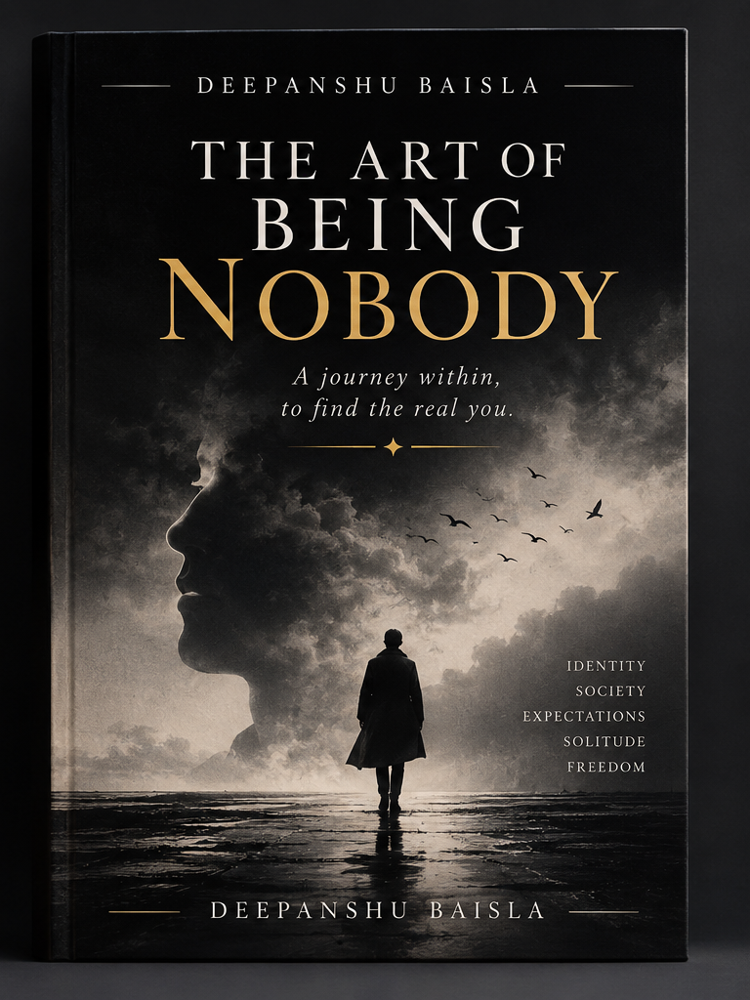

# The Art of Being Nobody

## Notes on identity, expectation, solitude, and the freedom to become

**Deepanshu Baisla**

## Introduction

We spend much of life collecting descriptions of ourselves. Student. Friend. Success. Failure. Quiet. Confident. The labels can be useful, but none of them is the whole person. This book explores the space between the person we perform and the person we are still becoming.

## 1. The Name Tag

A name is a useful beginning, not a complete definition. Soon after we learn our names, the world adds more labels: talented, difficult, responsible, different, successful. Some arrive as compliments; others arrive as limits.

Labels help people organise a complicated world. The trouble begins when we mistake the label for the person. A quiet student may have a busy imagination. A confident speaker may have private doubts. Someone who failed once is not a failure by nature.

Identity is not a box we discover and lock. It is a living conversation between memory, choice, relationships, and change. We can respect where we come from without allowing every old description to decide where we go.

Perhaps being nobody means refusing to let one label become the whole story.

## 2. The Audience in the Room

Even when we are alone, we sometimes behave as if an audience is watching. We imagine how a photograph will look, how a choice will be judged, or what people might say if we changed direction.

Other people's opinions matter in ordinary ways. We live together, depend on one another, and should listen when feedback is thoughtful. But imagined judgement can become louder than real experience. It can make us choose what looks impressive over what feels meaningful.

A useful question is: would I still value this choice if nobody applauded? The answer does not need to be yes every time. Recognition can be joyful. The question simply helps us notice whether applause is the only reason we are moving.

A life cannot be lived entirely from the seats of an imaginary audience. At some point, we must step onto our own stage.

## 3. The Noise of Comparison

Comparison takes a small piece of information and pretends it knows the whole story. We see someone's achievement but not their uncertainty, their support, their setbacks, or the time it took to arrive there.

There is a useful kind of comparison: looking at another person's work can teach us a skill or reveal a possibility. The unhelpful kind turns another person's progress into evidence against our own worth.

Our lives do not share one timetable. Different circumstances create different routes, and even people who appear to be travelling in the same direction may be carrying different responsibilities.

Instead of asking whether we are ahead, we can ask whether we are learning. Instead of measuring our life against a stranger's highlight, we can notice one small thing we understand better than we did yesterday.

## 4. Solitude Is a Room, Not a Verdict

Solitude can be a place to hear our own thoughts. It gives us time to read, make things, rest, or simply notice the day without constantly responding to someone else. Chosen solitude can be restorative.

But solitude and isolation are not identical. We can enjoy time alone and still need friendship, community, and support. Independence does not require pretending that we never need anyone.

The question is whether being alone feels chosen and nourishing, or whether it has become a barrier we do not know how to cross. If it is the latter, a small invitation—a message, a shared activity, a conversation with someone trustworthy—can be a meaningful beginning.

A room can offer quiet. It should not become a rule that keeps us from the world.

## 5. The Museum of Old Selves

Memory turns our past into a museum. We keep certain moments under bright lights and leave others in storage. Sometimes we visit an old mistake so often that we begin to think it is the only exhibit worth seeing.

But a person is more than their most embarrassing moment or their proudest achievement. We are also the ordinary days: the effort nobody noticed, the apology, the new interest, the small decision to try again.

Growth does not require disowning earlier versions of ourselves. They were real, even when they were incomplete. We can thank them for what they taught us and still choose differently now.

A museum preserves. A life continues. We are allowed to leave the gallery and make something new.

## 6. The Freedom to Change

Changing your mind can look inconsistent to people who only know the old version of you. Yet learning often changes what we believe. New evidence, new experiences, and deeper reflection can make an old certainty feel too small.

Of course, not every change is growth. Sometimes we change only to gain approval or escape a difficult conversation. The difference lies in whether we are acting with thought and responsibility.

We can explain a change without apologising for having learned. We can say, “I used to think this, but I understand it differently now.” That sentence is not weakness. It is intellectual honesty.

The self is not a statue. It is closer to a draft: revised by experience, strengthened by reflection, and never required to remain exactly as it was.

## 7. The Quiet Work of Becoming

Becoming is rarely cinematic. It is often a collection of small practices: keeping a promise to yourself, learning a skill, asking a better question, listening carefully, or taking responsibility after a mistake.

Because these actions are ordinary, they can be easy to overlook. We wait for a dramatic transformation and miss the steady work already happening. But character is shaped in repeated choices, especially the ones nobody is watching.

Progress also includes rest. A person is not a machine whose value rises with constant productivity. Reflection, play, friendship, and quiet time are part of a full life.

You do not need to announce every change. Some of the most meaningful growth happens before anyone else can name it.

## 8. Nobody, and Therefore Free

To be nobody is not to become invisible or to believe that you do not matter. It is to loosen your grip on the demand to be a fixed, impressive character in everyone else's story.

When we stop defending one perfect image, we gain room to be curious. We can be beginners. We can admit uncertainty. We can enjoy something without turning it into a brand. We can succeed without making success our entire identity, and fail without making failure our permanent name.

The world will keep offering descriptions. Some will be useful; some will be inaccurate; some will simply belong to another person's expectations. We can listen without surrendering the right to decide what we stand for.

Perhaps freedom begins when we stop asking, “Who must I appear to be?” and begin asking, “What kind of person do I want my choices to make me?”

---

*An original short philosophical work by Deepanshu Baisla.*
