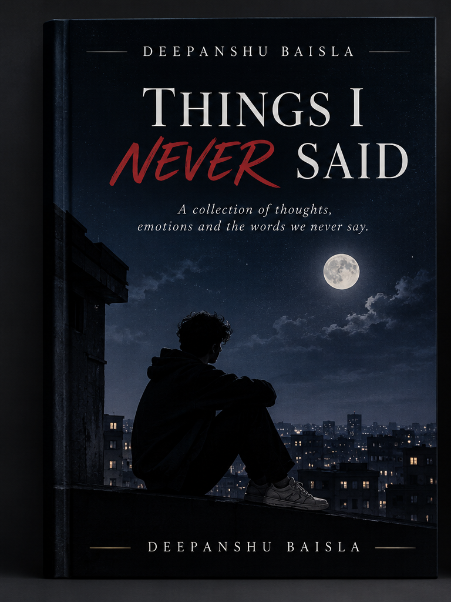

# Things I Never Said

## A collection of quiet questions, unfinished conversations, and the courage to be understood

**Deepanshu Baisla**

## Introduction

Some words never leave the mind. They wait behind ordinary conversations, hidden inside pauses, or appear when the world finally becomes quiet. This book is for those words—not because every silence is a secret, but because every person carries a private landscape that deserves attention.

## 1. The Language of Silence

Silence is often mistaken for emptiness. We assume that when someone says nothing, there is nothing to hear. Yet silence can hold a whole conversation: a thought being reconsidered, a feeling searching for a name, or a truth waiting for the right moment.

There are different kinds of silence. One is peaceful: the comfortable quiet between people who do not need to perform for each other. Another is uncertain: the pause before an honest answer. And another is protective: the quiet we choose when we do not yet know how to explain ourselves.

The important question is not whether we are silent, but why. Silence can give a thought room to grow, but it can also become a wall. Learning the difference is part of learning ourselves.

Perhaps the first thing we never say is the simplest: “I am still figuring out what I feel.” That sentence does not solve everything. It does, however, open a door.

## 2. Conversations Rehearsed at Midnight

Some conversations happen twice: once in the mind, and once—if courage and timing cooperate—in the world. In the imagined version, every sentence is perfect. We find the exact words, the perfect pause, the answer that makes everything clear.

Real conversations are less polished. People misunderstand. We forget what we meant to say. Sometimes the other person is carrying a story of their own and cannot hear ours fully.

That does not make speaking useless. It makes speaking human. The purpose of honesty is not to control another person's response. It is to offer them something real and allow them the freedom to respond.

A conversation rehearsed forever becomes a room with no exit. We can prepare, but eventually we must choose whether the truth deserves daylight. Even a small sentence—“Can I tell you something?”—can be a beginning.

## 3. The Distance Between Two People

Distance is not always measured in kilometres. Two people can sit across the same table and live in entirely different worlds. They may share jokes, photographs, and familiar routines while quietly changing in ways neither has noticed.

Closeness requires curiosity. It asks us to keep learning the person in front of us instead of treating an old memory as a complete description. People are not fixed portraits. They are moving stories.

Sometimes distance grows because nobody asks a second question. “How are you?” receives “Fine,” and the conversation moves on. A gentler question might be, “What has been on your mind lately?” It does not demand an answer, but it makes room for one.

We cannot force closeness. We can only make it safer for honesty to arrive. And we can remember that being understood begins with trying to understand.

## 4. The Things We Almost Said

An almost-said sentence can feel larger than a spoken paragraph. It follows us because it contains possibility: what might have changed if we had been clearer, kinder, or more direct?

But regret is not a reliable historian. It edits the past using information we only learned later. It tells us we should have known what we could not yet know. It turns uncertainty into a false certainty that one perfect sentence would have changed everything.

We can learn from the past without putting ourselves on trial. Perhaps next time we will ask instead of assume, explain instead of hint, or admit that we need time. These are practical forms of courage.

The sentence we almost said can still teach us something. It does not need to become a life sentence. We can carry its lesson forward and leave its impossible version of the past behind.

## 5. Being Seen, Not Studied

There is a difference between being noticed and being seen. A person can notice our clothes, our achievements, our mistakes, or the version of ourselves that appears in public. Being seen is quieter. It means someone pays attention without turning us into a puzzle to solve.

We sometimes hide behind a carefully edited personality because approval feels safer than uncertainty. We show the confident parts and keep the unfinished parts backstage. Yet real connection cannot grow from a performance alone.

Being seen does not mean telling everyone everything. Privacy is healthy. Trust is built gradually, through respect and consistency. We choose what to share, with whom, and when.

Maybe the wish beneath many unspoken words is not to be admired. It is to be met without pretending. That wish is reasonable, and it begins with offering ourselves the same patience we hope to receive.

## 6. The Courage of Ordinary Honesty

Honesty is often imagined as a dramatic confession. More often, it is ordinary. It is saying, “I do not know.” It is correcting a small misunderstanding. It is telling a friend that a joke hurt, without trying to hurt them back.

Ordinary honesty is powerful because it keeps small distances from becoming permanent. It gives people useful information instead of asking them to guess. It also requires boundaries: honesty is not permission to be cruel, and openness does not mean surrendering privacy.

A good truth can be both clear and kind. We can speak about what happened, how it affected us, and what we hope will happen next. We can leave room for the other person’s perspective.

The bravest sentence is not always the loudest. Sometimes it is simply, “I want to understand this better.”

## 7. Letters to Earlier Versions of Us

If we could write to an earlier version of ourselves, we might be tempted to give instructions: avoid this mistake, choose that path, do not worry so much. But a letter is not a time machine. Its deeper purpose may be compassion.

We could tell that younger self that confusion is not proof of failure. That changing your mind is allowed. That a difficult day is one page, not the whole book. We could remind them that people grow at different speeds and that comparison rarely tells the full story.

We should also remember that our earlier selves made choices with the understanding they had at the time. They deserve guidance, not contempt.

Perhaps we can write the letter now—not to change the past, but to change the way we speak to ourselves in the present.

## 8. A Place for the Unsaid

Not every thought needs to be spoken immediately. Some need time, some need privacy, and some become smaller once we understand them. The goal is not to empty the mind into every conversation. It is to stop treating our inner lives as unimportant.

We can make a place for the unsaid by writing, reflecting, asking for help, or choosing one trustworthy person with whom to be honest. We can also accept that some conversations will remain unfinished. Closure is not always delivered by another person; sometimes it grows from our own decision to move forward with care.

If this book has a final message, it is this: your words matter, but so does your timing. You do not owe the world every thought. You do owe yourself the chance to understand what is true.

When you are ready, begin with one honest sentence.

---

*An original short philosophical work by Deepanshu Baisla.*
